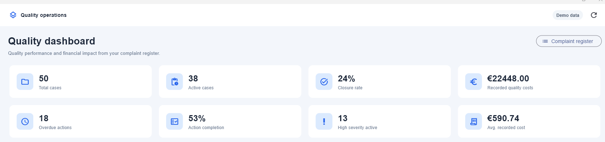
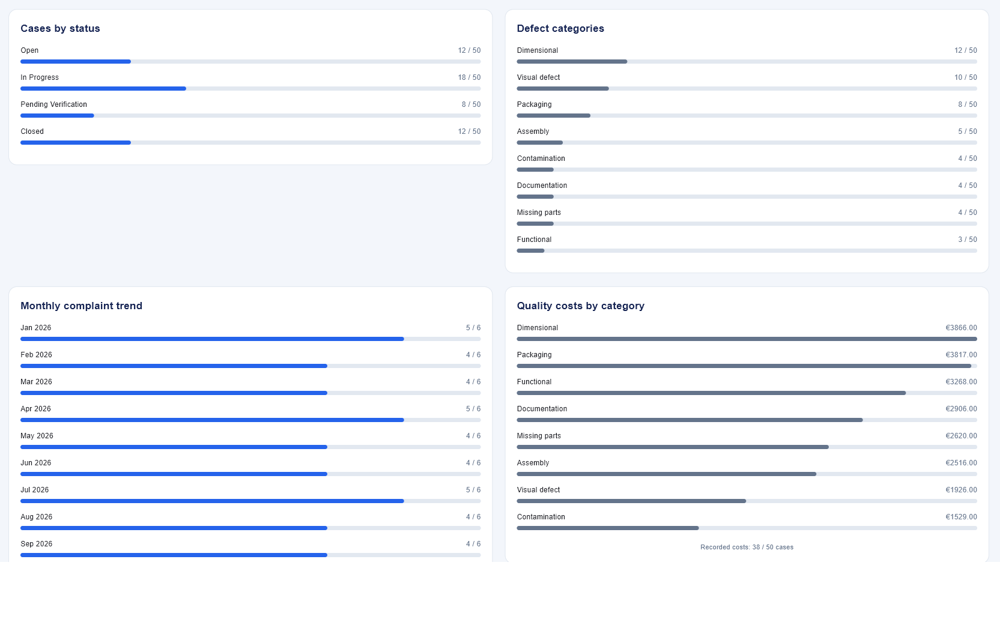
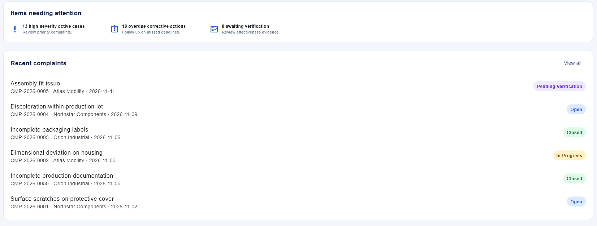
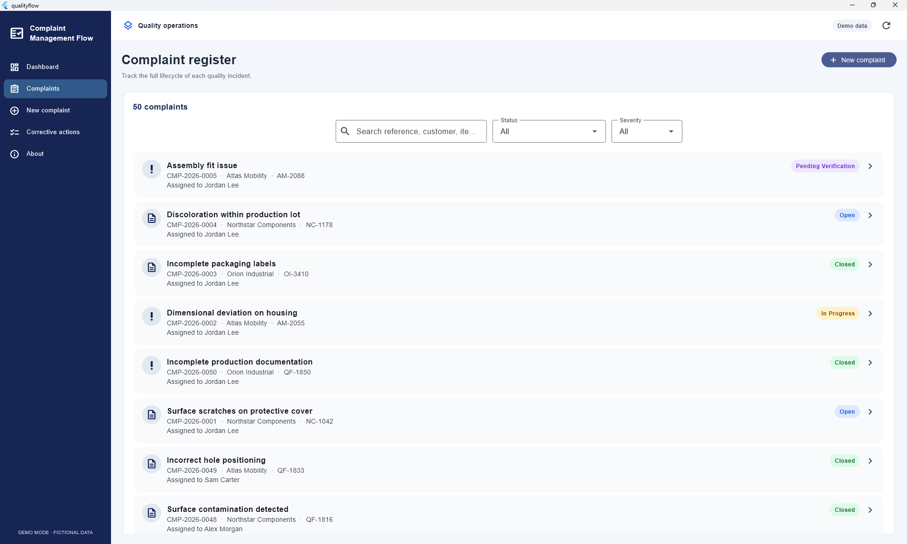
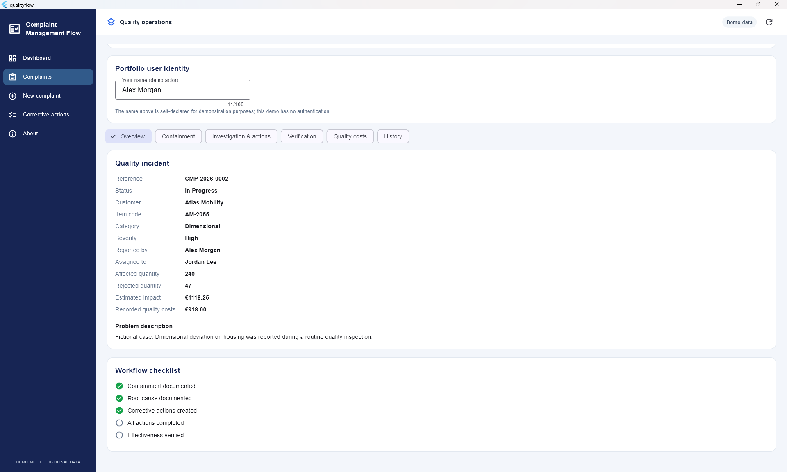
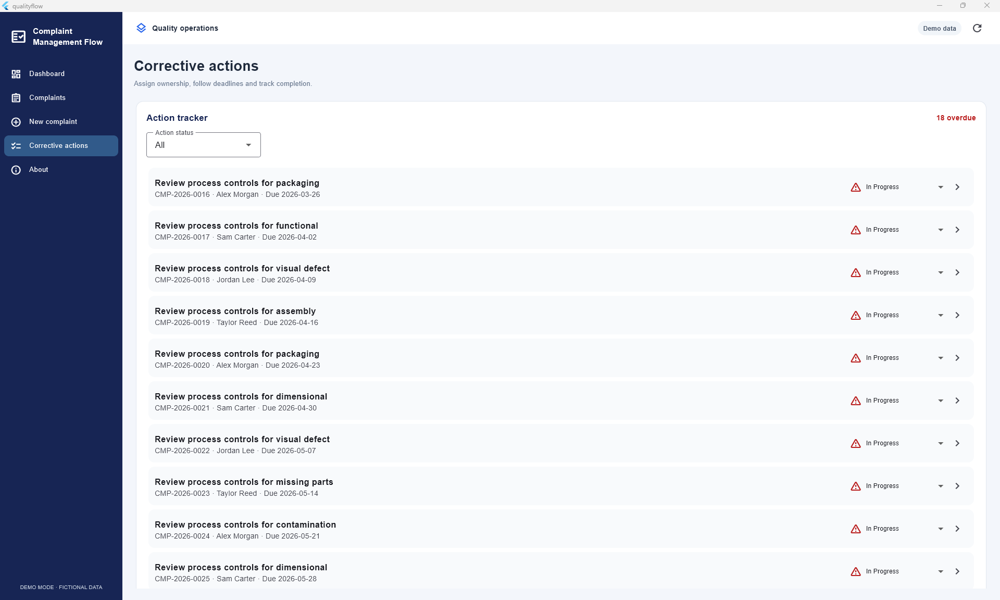
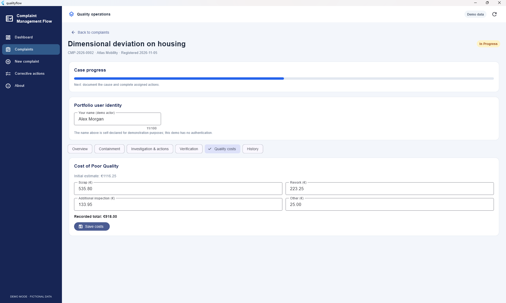
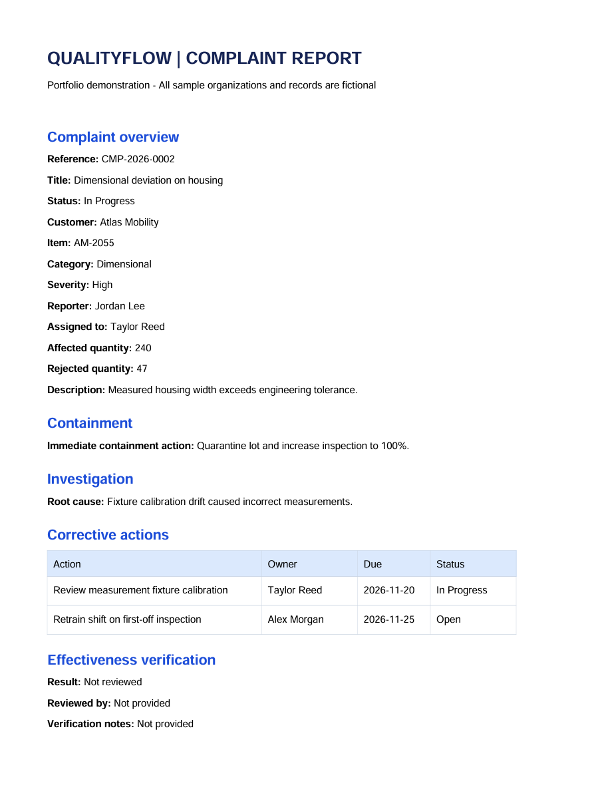

# QualityFlow

**A standalone industrial complaint management and non-conformity workflow application** built with Flutter, FastAPI and PostgreSQL.


> **Independent portfolio project.** QualityFlow is an educational demonstration application. All customers, employees, materials, complaints and sample records are fictional. It is designed for local demonstration, not production deployment.

## Why this project exists

Industrial quality management often relies on spreadsheets to document complaints, non-conformities and corrective actions.

While spreadsheets can register incidents, they do not inherently enforce process requirements, maintain structured relationships between records or provide consistent workflow validation.

QualityFlow demonstrates how these processes can be managed through a dedicated application with explicit state transitions, corrective action tracking, traceable changes, financial impact analysis and server-side validation.

The project also demonstrates the integration of a Flutter desktop frontend with a Python REST API and a relational PostgreSQL database.

## Features

- **Complaint register:** Create, search, filter and manage non-conformity records, including severity, category, assigned personnel and affected quantities.
- **Structured workflow:** Guide complaints through containment, investigation, corrective actions and effectiveness verification.
- **Protected transitions:** Prevent progression when mandatory workflow requirements have not been fulfilled.
- **Corrective action management:** Assign owners, due dates and statuses; track overdue and incomplete actions.
- **Quality cost management:** Record estimated financial impact and actual scrap, rework, inspection and other costs.
- **Analytics dashboard:** Monitor complaint volumes, closure rates, defect categories, severity distribution, overdue actions and financial KPIs.
- **Activity history:** Record relevant changes and workflow transitions, with manually declared actor names.
- **PDF reporting (API mode):** Generate reports covering complaint information, containment, investigation, corrective actions, effectiveness verification and quality costs.
- **Two execution modes:** Explore fictional data without external infrastructure or use a persistent FastAPI/PostgreSQL backend.
- **Automated verification:** Flutter tests, Python backend tests and GitHub Actions continuous integration.

### Workflow

The application follows four complaint states:

`Open → In Progress → Pending Verification → Closed`

Business rules enforce the following conditions:

1. Containment must be documented before investigation begins.
2. Root cause documentation and at least one completed corrective action are required before effectiveness verification.
3. All corrective actions must be completed before submission for verification.
4. Closure requires an effective verification result, supporting notes and a reviewer.
5. Ineffective verification allows the complaint to return to investigation.
6. Closed complaints cannot be reopened or edited through the implemented API operations.

These rules are enforced by the backend independently of the Flutter interface.

## Screenshots

Screenshots of the application were added under `docs/screenshots/`.

### Dashboard & Analytics

QualityFlow provides an overview of complaint management performance, workflow distribution and financial impact.







### Complaint Management

Register, review and manage complaints throughout their lifecycle.





### Corrective Actions

Track assigned responsibilities, deadlines and action completion.



### Quality Costs

Monitor estimated financial impact and recorded quality-related costs.



### PDF Reporting

Generate structured complaint reports through the FastAPI backend.




## Reviewer walkthrough

See [docs/RECRUITER_DEMO.md](docs/RECRUITER_DEMO.md) for a guided demonstration of complaint registration, workflow validation, corrective actions, effectiveness verification and PDF reporting.

## Technology stack

| Layer | Technology | Purpose |
|---|---|---|
| Frontend | Flutter / Dart | Windows desktop application |
| Backend | Python / FastAPI | REST API and business logic |
| Database | PostgreSQL | Persistent relational storage |
| Database access | psycopg | PostgreSQL connectivity |
| Data validation | Pydantic | Request validation and constraints |
| Reporting | ReportLab | Server-side PDF generation |
| Testing | flutter_test / pytest | Automated verification |
| Continuous integration | GitHub Actions | Automated analysis and tests |

## Architecture

QualityFlow separates presentation, data access, business rules and persistence.

```text
Flutter Desktop Application
          |
          v
Complaint Repository Interface
          |
    +-----+------+
    |            |
    v            v
Demo Repository  API Repository
(In-memory)           |
                      v
                  FastAPI
                      |
               Business Rules
                      |
                      v
                  PostgreSQL
```

The Flutter application accesses complaint data through a repository abstraction.

This allows the same interface to run with either an in-memory demonstration repository or a persistent API-backed repository.

In API mode, FastAPI validates requests, enforces workflow rules and performs database operations.

PostgreSQL stores complaints, corrective actions and activity events.

## Project structure

```text

qualityflow/
├── .github/
│   └── workflows/
│       ├── flutter_ci.yml
│       └── python_ci.yml
├── backend/
│   ├── app/
│   │   ├── __init__.py
│   │   ├── domain.py
│   │   ├── main.py
│   │   └── reporting.py
│   ├── sql/
│   │   ├── 001_schema.sql
│   │   └── 002_seed_demo.sql
│   ├── tests/
│   │   ├── test_pdf.py
│   │   ├── test_validation.py
│   │   └── test_workflow.py
│   ├── .env.example
│   ├── compose.yaml
│   ├── pytest.ini
│   ├── requirements.txt
│   └── requirements-dev.txt
├── docs/
│   ├── screenshots/
│   │   ├── dashboard-overview.png
│   │   ├── dashboard-complaints.png
│   │   ├── dashboard-analytics.png
│   │   ├── complaint-register.png
│   │   ├── complaint-details.png
│   │   ├── corrective-actions.png
│   │   ├── quality-costs.png
│   │   └── pdf-report.png
│   ├── ARCHITECTURE.md
│   └── RECRUITER_DEMO.md
├── lib/
│   ├── models/
│   │   └── complaint.dart
│   ├── pages/
│   │   ├── about_page.dart
│   │   ├── actions_page.dart
│   │   ├── complaint_detail_page.dart
│   │   ├── complaints_page.dart
│   │   ├── dashboard_page.dart
│   │   └── new_complaint_page.dart
│   ├── services/
│   │   └── complaint_repository.dart
│   ├── widgets/
│   │   └── app_widgets.dart
│   └── main.dart
├── test/
│   ├── demo_workflow_test.dart
│   └── widget_test.dart
├── windows/
│   └── runner/
│       └── resources/
│           └── app_icon.ico
├── .gitignore
├── analysis_options.yaml
├── pubspec.yaml
├── pubspec.lock
└── README.md

```

## Quick start — Offline Demo Mode

**Requirements:** Flutter SDK with Windows desktop support.

From the project root:

```powershell
flutter pub get
flutter analyze
flutter run -d windows
```

The application starts in Demo Mode by default.

Demo Mode includes 50 fictional complaints with different statuses, defect categories, severity levels, corrective actions and quality costs.

Users can create complaints, update workflow information, manage corrective actions and explore dashboard analytics without configuring a database or API.

**Demo Mode limitations:**

- All information is stored in memory.
- Changes are lost when the application restarts.
- PDF generation requires API Mode.
- No backend or PostgreSQL installation is required.

Run Flutter tests with:

```powershell
flutter test
```

## Full Stack — FastAPI + PostgreSQL

API Mode connects the Flutter application to a local FastAPI backend and PostgreSQL database.

Unlike Demo Mode, changes persist between application sessions.

### Option A: Docker PostgreSQL

**Requirements:** Docker Desktop, Python and Flutter.

From the project root:

```powershell
cd backend
docker compose up -d db
Copy-Item .env.example .env
py -3 -m venv .venv
.\.venv\Scripts\python.exe -m pip install -r requirements-dev.txt
.\.venv\Scripts\python.exe -m uvicorn app.main:app --host 127.0.0.1 --port 8000 --reload
```

The documented Docker configuration uses PostgreSQL on `127.0.0.1:5433` to avoid conflicts with a default PostgreSQL installation on port 5432.

The Docker setup is intended for local demonstration only. Review the `.env` configuration before launching the API.

Database initialization scripts should be applied only to a fresh demonstration database. Docker initialization scripts normally run only when the database volume is first created.

Open the interactive API documentation:

http://127.0.0.1:8000/docs

### Start Flutter in API Mode

In another terminal, from the Flutter project root:

```powershell
flutter run -d windows --dart-define=USE_API=true --dart-define=API_BASE_URL=http://127.0.0.1:8000
```

### Option B: Existing Local PostgreSQL Installation

Alternatively, use an existing local PostgreSQL installation.

1. Create a new, empty demonstration database.
2. Execute `backend/sql/001_schema.sql`.
3. Execute `backend/sql/002_seed_demo.sql`.
4. Configure `DATABASE_URL` in `backend/.env`.
5. Start the FastAPI server using the Uvicorn command above.
6. Launch Flutter in API Mode.

**Important:** The SQL scripts are intended for a new demo database. They must not be executed against an existing corporate or production database.

## API endpoints

| Method | Endpoint | Purpose |
|---|---|---|
| GET | `/api/health` | Check API and database connectivity |
| GET | `/api/complaints` | List complaints |
| POST | `/api/complaints` | Create a complaint |
| GET | `/api/complaints/{id}` | Retrieve a complaint |
| PATCH | `/api/complaints/{id}/containment` | Update containment information |
| PATCH | `/api/complaints/{id}/investigation` | Update root cause |
| PATCH | `/api/complaints/{id}/verification` | Record effectiveness verification |
| PATCH | `/api/complaints/{id}/costs` | Update quality costs |
| POST | `/api/complaints/{id}/transition` | Change complaint status |
| GET | `/api/actions` | List corrective actions |
| POST | `/api/complaints/{id}/actions` | Create a corrective action |
| PATCH | `/api/actions/{id}` | Update corrective action status |
| GET | `/api/complaints/{id}/events` | Retrieve activity history |
| GET | `/api/complaints/{id}/report.pdf` | Generate a PDF report |

## Quality Cost Analysis

QualityFlow supports two financial perspectives:

**Estimated financial impact**

An initial estimate of the potential financial impact associated with a complaint.

**Recorded actual costs**

Actual costs can be registered in four categories:

- Scrap
- Rework
- Inspection
- Other costs

The recorded quality cost total is calculated from the available actual cost values.

An estimated cost is not included in the actual cost total, and missing values are distinguished from explicitly recorded zero values.

Financial indicators are displayed in the dashboard and included in API-generated PDF reports.

## Testing and Continuous Integration

QualityFlow includes automated testing for both the Flutter application and the Python backend.

### Flutter

The Flutter test suite covers selected application and demo-workflow behavior.

Local verification:

```powershell
flutter analyze
flutter test
```

### Python / FastAPI

The Python backend includes **21 automated tests**, covering:

- Workflow transition rules
- Mandatory containment and investigation information
- Corrective action completion requirements
- Effectiveness verification requirements
- Invalid status transitions
- Quantity validation
- Financial input validation
- Decimal precision
- Closed complaint editing restrictions
- PDF generation and financial report content

Run the backend tests from the project root:

```powershell
python -m pip install -r backend/requirements-dev.txt
python -m pytest backend/tests -v
```

### GitHub Actions

Two independent CI workflows run automatically on repository pushes and pull requests:

**Flutter CI**

- Install Flutter dependencies
- Run static analysis
- Execute Flutter tests

**Python CI**

- Configure Python
- Install backend dependencies
- Execute pytest tests

Both workflows have been executed successfully.

### Testing limitations

Automated backend tests focus primarily on business rules, request validation and report generation.

Full PostgreSQL persistence and end-to-end UI/API workflows have been manually verified, but are not covered by an automated database integration test suite.

## Security Limitations

**QualityFlow is a local portfolio demonstration, not a production-ready enterprise system.**

The current version does not implement:

- User authentication
- Server-side role-based authorization
- HTTPS/TLS termination
- Verified individual audit attribution
- Production secrets management and deployment hardening

Activity history records manually declared actors and should not be considered a tamper-proof audit trail.

The FastAPI server should remain bound to `127.0.0.1` for local use.

Do not expose the API to untrusted networks or use it with real confidential business information.

Sample database credentials are intended strictly for local demonstration environments.

No corporate servers, identities, proprietary documents or private datasets are required to run the project.

## Design Decisions and Trade-offs

- **Two repository implementations:** Demo Mode provides an accessible standalone experience, while API Mode demonstrates persistent full-stack integration.
- **Backend validation:** Important workflow rules are enforced in Python and cannot be bypassed merely by modifying Flutter requests.
- **Relational storage:** PostgreSQL stores related complaints, corrective actions and activity events.
- **Structured financial data:** Monetary values are validated using decimal constraints.
- **Server-side PDF generation:** ReportLab generates consistent reports independently of the Flutter UI.
- **Limited external dependencies:** The frontend is kept relatively lightweight.
- **Defined scope:** Authentication, enterprise deployment and advanced administration are deliberately excluded from the initial release.

## AI-Assisted Development

QualityFlow was developed as an independent, AI-assisted software engineering and portfolio project.

AI tools were used to support code generation, implementation, debugging, technical explanations, refactoring and test development.

The project was guided through hands-on definition of functional requirements, workflow behavior, architectural decisions, interface design, integration, manual verification and iterative testing.

The objective is to demonstrate practical problem-solving, the ability to translate operational requirements into software, and an understanding of how frontend, backend, database and testing components work together.

AI assistance is disclosed transparently and is treated as part of the development workflow rather than as a substitute for validation.

## Project Scope

QualityFlow v1.0.0 is intended to demonstrate a functional complaint management workflow and its supporting full-stack architecture.

It is not a certified quality management system or a replacement for an enterprise QMS.

Potential future extensions include authentication, authorization, attachments, database migrations, expanded integration testing and deployment hardening.