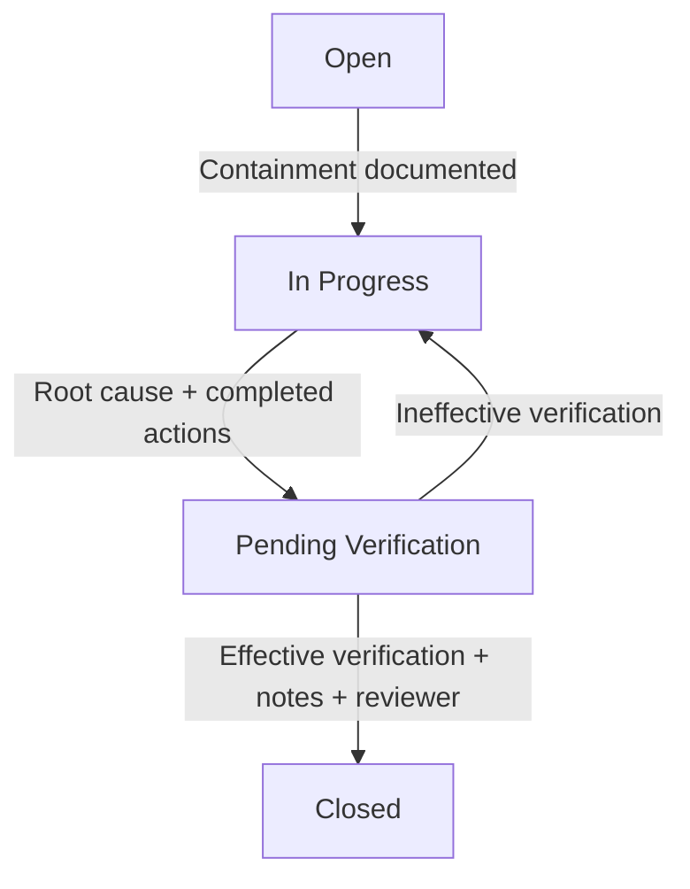

# Architecture and Workflow

## Overview

The frontend uses a `ComplaintRepository` interface. Two implementations provide the same core operations:

1. `DemoComplaintRepository` holds fictional records in memory and requires no external infrastructure.
2. `ApiComplaintRepository` invokes FastAPI routes, which validate changes and persist records to PostgreSQL.

The repository abstraction allows the Flutter interface to operate in either mode without maintaining separate user interfaces.

Demo Mode provides 50 fictional complaints for exploring the application. Changes are not persisted between sessions.

API Mode provides database persistence, server-side business validation and PDF generation.

## State Machine

- All transitions are explicit. Skipping stages is prohibited.
- Containment must be documented before moving from `Open` to `In Progress`.
- Investigation requires a documented root cause and at least one corrective action.
- All corrective actions must be completed before submitting for verification.
- An ineffective verification allows the complaint to return to investigation, resetting previous verification fields.
- Closure requires effective verification, supporting notes and a reviewer.
- Closed complaints are read-only; historical actions and details remain available.
- Business fields can be saved without automatically advancing the workflow.
- PostgreSQL row locks (`FOR UPDATE`) help serialize relevant complaint transitions and action updates.

The backend validates workflow transitions independently of the Flutter interface.

## Core Data Model

The PostgreSQL database contains three principal business tables:

- `complaints`: Incident details, customer, item, quantities, ownership, containment, root cause, verification, status and financial information.
- `corrective_actions`: Linked corrective actions, responsible person, due date, status and completion timestamp.
- `complaint_events`: Timestamped business events, human-readable messages and manually declared actors.

Complaints can have multiple corrective actions and history events.

All sample names and reference codes are fictional.

Database IDs are generated using PostgreSQL sequences. Complaint references combine a year prefix with the assigned database ID.

## Quality Cost Management

QualityFlow records estimated financial impact and actual quality-related costs.

The `complaints` table includes:

- `estimated_cost`
- `scrap_cost`
- `rework_cost`
- `inspection_cost`
- `other_cost`

Financial input is validated by Pydantic using decimal constraints, including non-negative values and a maximum of two decimal places.

The actual quality cost total is calculated from recorded actual cost categories:

`Actual total = Scrap + Rework + Inspection + Other`

The estimated cost is not included in this total.

Missing cost values are distinguished from explicitly recorded zero values.

Financial metrics are calculated from complaint records and displayed in the Flutter dashboard.

## PDF Reporting

In API Mode, FastAPI uses ReportLab to generate PDF reports on demand.

Reports contain:

- Complaint overview
- Containment information
- Root cause investigation
- Corrective actions
- Effectiveness verification
- Estimated and actual quality costs

The report generator uses `Decimal` for monetary calculations.

The PDF is generated by the backend and returned to the Flutter client. Demo Mode does not provide PDF export.

## Testing and Continuous Integration

The project uses automated tests to validate selected frontend behavior and backend business rules.

- Flutter: Static analysis, widget tests and demo-workflow tests.
- Python: 21 tests covering workflow rules, data validation, financial constraints and PDF reporting.
- GitHub Actions: Independent Flutter and Python CI workflows.

Full PostgreSQL persistence and end-to-end application workflows have also been verified manually.

Automated PostgreSQL integration testing is outside the scope of the initial release.

## Scope and Limitations

QualityFlow is an independent portfolio application, not a production-ready multi-user system.

It deliberately excludes authentication, role-based authorization, HTTPS termination and enterprise deployment hardening.

Activity history uses manually declared actor names and does not provide verified audit attribution.

The backend should be executed on localhost only.

Dashboard metrics are calculated from the loaded complaints and corrective actions; no separate analytics database is required.