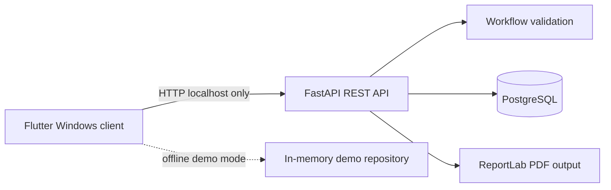
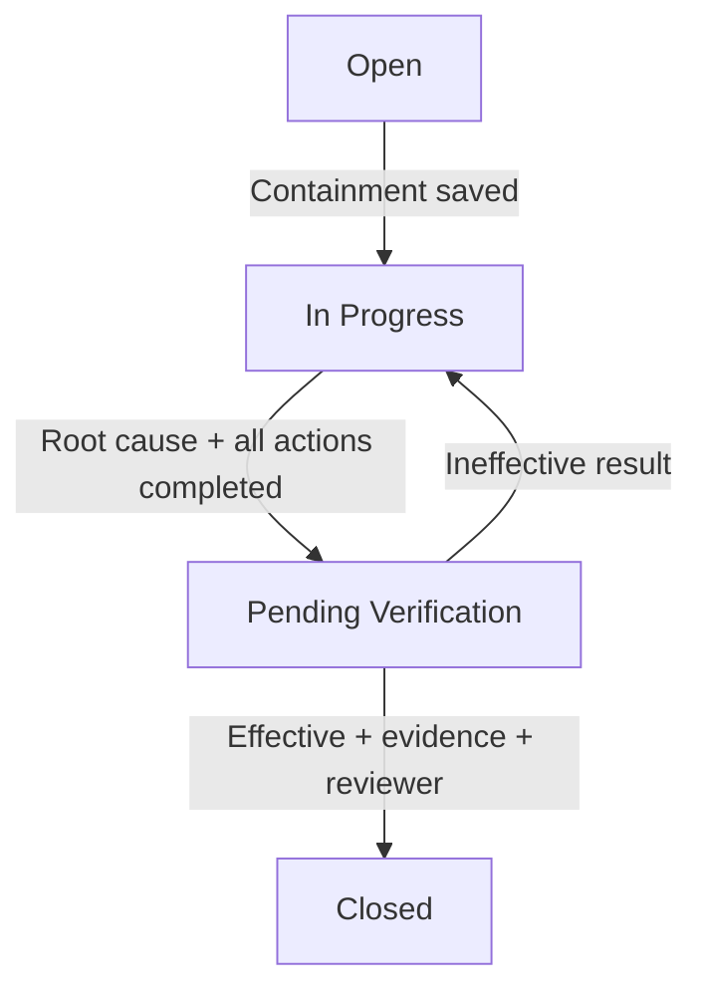

# Architecture and workflow

## Overview

The frontend uses a `ComplaintRepository` interface. Two implementations provide the same operations:

1. `DemoComplaintRepository` holds fictional records in memory and requires no infrastructure.
2. `ApiComplaintRepository` invokes FastAPI routes, which validate changes and persist records to PostgreSQL.

## State machine

- All transitions are explicit. Skipping stages is prohibited.
- An investigation needs at least one corrective action and **all actions must be completed**.
- An ineffective verification returns the complaint for rework, resetting the previous verification fields.
- A closed complaint is read-only; historical actions and details remain available.
- Business fields can be saved without moving to the next stage.
- PostgreSQL row locks (`FOR UPDATE`) serialize relevant case transitions and action updates.

## Core data model

- `complaints`: incident details, owner, quantity, containment, root cause, verification and status.
- `corrective_actions`: linked actions, owner, due date, status and completion timestamp.
- `complaint_events`: timestamped event records, human-readable messages and manually declared actor.

All names and reference codes are invented for this independent demo. IDs are generated by PostgreSQL; the public complaint reference uses a year prefix and the monotonically increasing database ID.

## Scope and limitations

This is a portfolio application, not a multi-user production system. It deliberately excludes Entra ID, authentication, role enforcement, security hardening and enterprise deployment. Only run the backend on localhost. ReportLab generates PDF reports on demand in API mode. Dashboard metrics are computed from the loaded complaints and actions; no separate analytics database is required.
